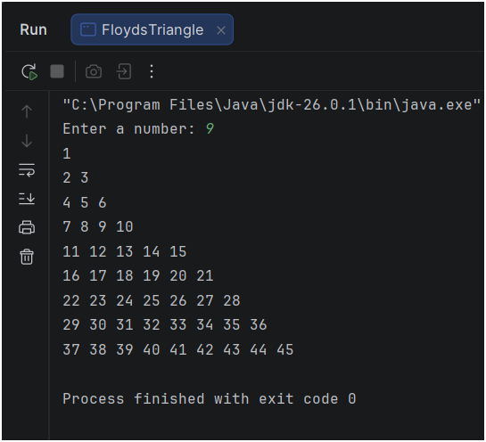

## Java Practice Question – Floyd's Triangle Pattern

This folder contains a Java program that solves a **pattern-printing practice question** demonstrating how to generate Floyd's Triangle using nested loops and a continuous counter variable.

It is intended for beginners to strengthen their understanding of **core Java fundamentals**, specifically tracking state across nested `for` loops and formatting sequential numerical output.

## 📌 Program Overview

The program in this folder covers the following practice concepts:

* Reading the number of rows (`n`) from the user using the `Scanner` class.

* Initializing a separate counter variable (e.g., `int a = 1;`) outside the loops to maintain a continuous sequence of numbers.

* Using an outer `for` loop (`i` from `1` to `n`) to control the total number of rows in the triangle.

* Using an inner `for` loop (`j` from `1` to `i`) to print the current counter value and increment it (`a++`) on each step.

## 🧪 Code Functionality

The program demonstrates:

### Nested Loops & Sequential State Tracking

* **User Input**: Prompts the user to enter the number of rows (`n`) for the triangle.

* **Pattern Generation**: Prints consecutive natural numbers starting from `1`, increasing the count of numbers printed on each subsequent row, and moves to a new line with `System.out.println()` once each row completes.

The program is written in a **simple and readable format**, making it ideal for beginners learning how to decouple printed values from loop index variables in Java.

## 🖥️ Output

The program prompts the user for the number of rows and prints Floyd's Triangle in the console.

The complete console output for this practice question is shown below:

## 📂 File Information

* `FloydsTriangle.java` — Contains the practice question program

* `Output.png` — Screenshot of console output

* `README.md` — Folder documentation

## 👨‍💻 Author

**MD Shahnawaz Noor**

*Aspiring Data Scientist*

GitHub: <https://github.com/shahnawaznoor2020-code>

Email: shahnawaznoor2020@gmail.com

## ⭐ Note

These practice programs help build a strong foundation in Java.

Practicing Floyd's Triangle strengthens your ability to manage independent counter variables alongside nested loop structures.