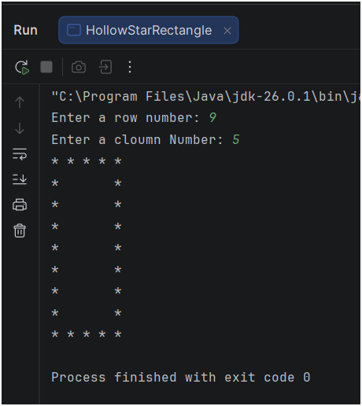

## Java Practice Question – Hollow Star Rectangle Pattern

This folder contains a Java program that solves a **pattern-printing practice question** demonstrating how to generate a hollow rectangle made of asterisks (`*`) using nested loops and conditional logic.

It is intended for beginners to strengthen their understanding of **core Java fundamentals**, specifically combining grid-based nested `for` loops with `if-else` boundary conditions.

## 📌 Program Overview

The program in this folder covers the following practice concepts:

* Reading the number of rows (`m`) and columns (`n`) from the user using the `Scanner` class.

* Using an outer `for` loop (`i` from `1` to `m`) to iterate through each row of the rectangle.

* Using an inner `for` loop (`j` from `1` to `n`) to iterate through each column in the current row.

* Applying a boundary condition (`i == 1 || i == m || j == 1 || j == n`) to print `*` along the outer edges and spaces (`" "`) in the interior.

## 🧪 Code Functionality

The program demonstrates:

### Nested Loops & Boundary Conditional Logic

* **User Input**: Prompts the user to enter the dimensions (rows and columns) for the rectangle.

* **Pattern Generation**: Prints a star (`*`) only when the current position lies on the first row, last row, first column, or last column; otherwise, it prints a blank space to create the hollow interior, moving to a new line via `System.out.println()` after each row.

The program is written in a **simple and readable format**, making it ideal for beginners learning how to control 2D console output using coordinate-based conditions in Java.

## 🖥️ Output

The program prompts the user for the number of rows and columns and prints the hollow star rectangle in the console.

The complete console output for this practice question is shown below:

## 📂 File Information

* `HollowStarRectangle.java` — Contains the practice question program

* `Output.png` — Screenshot of console output

* `README.md` — Folder documentation

## 👨‍💻 Author

**MD Shahnawaz Noor**

*Aspiring Data Scientist*

GitHub: <https://github.com/shahnawaznoor2020-code>

Email: shahnawaznoor2020@gmail.com

## ⭐ Note

These practice programs help build a strong foundation in Java.

Practicing hollow patterns strengthens your ability to combine nested loop coordinates with logical `OR` (`||`) conditions.