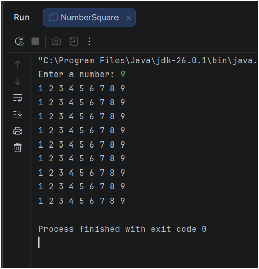

## Java Practice Question – Number Square Pattern

This folder contains a Java program that solves a **pattern-printing practice question** demonstrating how to generate a square grid filled with sequential numbers using nested `for` loops.

It is intended for beginners to strengthen their understanding of **core Java fundamentals**, specifically controlling row-and-column iteration and printing numerical sequences across grid dimensions.

## 📌 Program Overview

The program in this folder covers the following practice concepts:

* Reading the size of the square (`n`) from the user using the `Scanner` class.

* Using an outer `for` loop (`i` from `1` to `n`) to iterate through each row of the square.

* Using an inner `for` loop (`j` from `1` to `n`) to print numbers from `1` to `n` across each row.

* Using `System.out.print()` for inline number formatting and `System.out.println()` to transition to the next row.

## 🧪 Code Functionality

The program demonstrates:

### Nested Loops & Numerical Grid Formatting

* **User Input**: Prompts the user to enter an integer `n` representing the number of rows and columns in the square.

* **Pattern Generation**: Iterates through `n` rows and prints the column index `j` (`1` through `n`) separated by spaces on every row, forming an $n \times n$ square of numbers.

The program is written in a **simple and readable format**, making it ideal for beginners learning how nested loops govern 2D console layouts in Java.

## 🖥️ Output

The program prompts the user for the size `n` and prints the number square pattern in the console.

The complete console output for this practice question is shown below:

## 📂 File Information

* `NumberSquare.java` — Contains the practice question program

* `Output.png` — Screenshot of console output

* `README.md` — Folder documentation

## 👨‍💻 Author

**MD Shahnawaz Noor**

*Aspiring Data Scientist*

GitHub: <https://github.com/shahnawaznoor2020-code>

Email: shahnawaznoor2020@gmail.com

## ⭐ Note

These practice programs help build a strong foundation in Java.

Practicing number grid patterns reinforces how inner loop variables can be directly printed to structure tabular console outputs.