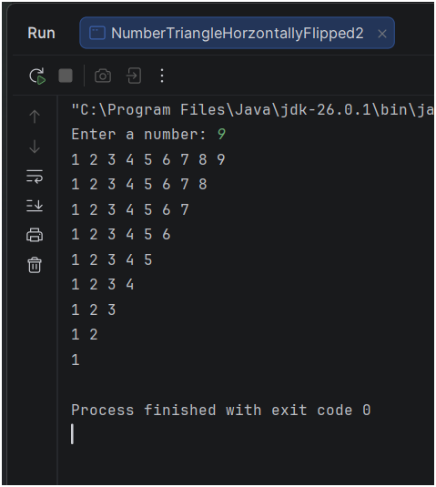

## Java Practice Question – Horizontally Flipped Number Triangle Pattern (Variation 2)

This folder contains a Java program that solves a **pattern-printing practice question** demonstrating a second variation of an inverted (horizontally flipped) right-angled triangle filled with numbers using nested `for` loops.

It is intended for beginners to strengthen their understanding of **core Java fundamentals**, specifically controlling decreasing column iterations per row and manipulating numerical output patterns (such as printing repeated row indices or descending numbers) in inverted triangular structures.

## 📌 Program Overview

The program in this folder covers the following practice concepts:

* Reading the number of rows (`n`) from the user using the `Scanner` class.

* Using an outer `for` loop (`i` from `1` to `n`) to iterate through each row of the inverted triangle.

* Using an inner `for` loop (`j` from `1` to `n + 1 - i`) to print decreasing counts of numbers on each subsequent row according to the variation's logic.

* Using `System.out.print()` for inline number formatting and `System.out.println()` to move to the next line after each row.

## 🧪 Code Functionality

The program demonstrates:

### Nested Loops & Inverted Numerical Pattern Variation

* **User Input**: Prompts the user to enter an integer `n` representing the height (number of rows) of the triangle.

* **Pattern Generation**: Iterates through `n` rows and prints numbers across `n + 1 - i` columns separated by spaces, creating a horizontally flipped number triangle variation where the widest row is at the top.

The program is written in a **simple and readable format**, making it ideal for beginners learning how to control loop boundaries and numerical expressions in Java.

## 🖥️ Output

The program prompts the user for the number of rows `n` and prints the horizontally flipped number triangle pattern variation in the console.

The complete console output for this practice question is shown below:

## 📂 File Information

* `NumberTriangleHorzontallyFlipped2.java` — Contains the practice question program

* `Output.png` — Screenshot of console output

* `README.md` — Folder documentation

## 👨‍💻 Author

**MD Shahnawaz Noor**

*Aspiring Data Scientist*

GitHub: <https://github.com/shahnawaznoor2020-code>

Email: shahnawaznoor2020@gmail.com

## ⭐ Note

These practice programs help build a strong foundation in Java.

Practicing multiple variations of flipped number triangle patterns reinforces how subtle changes in print statements and loop variables alter console output structures.