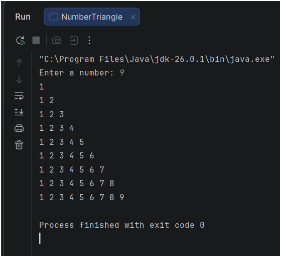

## Java Practice Question – Number Triangle Pattern

This folder contains a Java program that solves a **pattern-printing practice question** demonstrating how to generate a right-angled triangle filled with sequential numbers using nested `for` loops.

It is intended for beginners to strengthen their understanding of **core Java fundamentals**, specifically controlling row-dependent column iteration and printing numerical sequences in triangular structures.

## 📌 Program Overview

The program in this folder covers the following practice concepts:

* Reading the number of rows (`n`) from the user using the `Scanner` class.

* Using an outer `for` loop (`i` from `1` to `n`) to iterate through each row of the triangle.

* Using an inner `for` loop (`j` from `1` to `i`) to print numbers from `1` up to the current row number `i`.

* Using `System.out.print()` for inline number formatting and `System.out.println()` to move to the next line after each row.

## 🧪 Code Functionality

The program demonstrates:

### Nested Loops & Triangular Numerical Formatting

* **User Input**: Prompts the user to enter an integer `n` representing the height (number of rows) of the triangle.

* **Pattern Generation**: Iterates through `n` rows and prints the column index `j` (`1` through `i`) separated by spaces on each row, forming a right-angled number triangle.

The program is written in a **simple and readable format**, making it ideal for beginners learning how inner loop bounds depend on outer loop counters in Java.

## 🖥️ Output

The program prompts the user for the number of rows `n` and prints the number triangle pattern in the console.

The complete console output for this practice question is shown below:

## 📂 File Information

* `NumberTriangle.java` — Contains the practice question program

* `Output.png` — Screenshot of console output

* `README.md` — Folder documentation

## 👨‍💻 Author

**MD Shahnawaz Noor**

*Aspiring Data Scientist*

GitHub: <https://github.com/shahnawaznoor2020-code>

Email: shahnawaznoor2020@gmail.com

## ⭐ Note

These practice programs help build a strong foundation in Java.

Practicing number triangle patterns reinforces how inner loop limits control progressive row growth in console outputs.