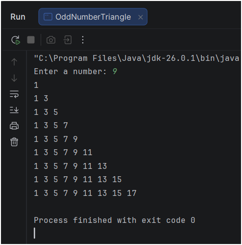

## Java Practice Question – Odd Number Triangle Pattern

This folder contains a Java program that solves a **pattern-printing practice question** demonstrating how to print a right-angled triangle filled with consecutive odd numbers using nested `for` loops.

It is intended for beginners to strengthen their understanding of **core Java fundamentals**, specifically controlling inner loop increments or mathematical expressions (`2 * j - 1`) to generate odd number sequences across rows in the console.

## 📌 Program Overview

The program in this folder covers the following practice concepts:

* Reading the number of rows (`n`) from the user using the `Scanner` class.

* Using an outer `for` loop (`i` from `1` to `n`) to iterate through each row of the triangle.

* Using an inner `for` loop (`j` from `1` to `i`) to print the first `i` odd numbers (`1, 3, 5, ...`) on each row.

* Using `System.out.print()` for inline formatting and `System.out.println()` to move to the next line after each row.

## 🧪 Code Functionality

The program demonstrates:

### Nested Loops & Odd Number Sequence Generation

* **User Input**: Prompts the user to enter an integer `n` representing the height (number of rows) of the triangle.

* **Pattern Generation**: For each row `i`, prints odd numbers starting from `1` up to the `i`-th odd number (`2 * i - 1`) separated by spaces, creating a clean odd-numbered right-angled triangle.

The program is written in a **simple and readable format**, making it ideal for beginners learning how to generate arithmetic sequences within nested loops in Java.

## 🖥️ Output

The program prompts the user for the number of rows `n` and prints the odd number triangle pattern in the console.

The complete console output for this practice question is shown below:

## 📂 File Information

* `OddNumberTriangle.java` — Contains the practice question program

* `Output.png` — Screenshot of console output

* `README.md` — Folder documentation

## 👨‍💻 Author

**MD Shahnawaz Noor**

*Aspiring Data Scientist*

GitHub: <https://github.com/shahnawaznoor2020-code>

Email: shahnawaznoor2020@gmail.com

## ⭐ Note

These practice programs help build a strong foundation in Java.

Practicing sequence-based patterns reinforces how arithmetic expressions inside nested loops control numerical output in console programs.