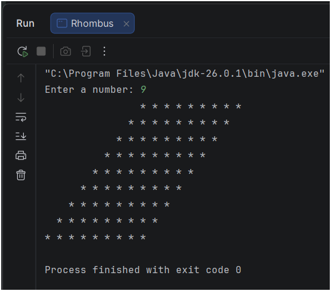

## Java Practice Question – Solid Rhombus Pattern

This folder contains a Java program that solves a **pattern-printing practice question** demonstrating how to print a slanted solid rhombus pattern using nested `for` loops.

It is intended for beginners to strengthen their understanding of **core Java fundamentals**, specifically combining decreasing leading spaces with a fixed-width row of stars (`*`) to create tilted geometric shapes in the console.

## 📌 Program Overview

The program in this folder covers the following practice concepts:

* Reading the size/number of rows (`n`) from the user using the `Scanner` class.

* Using an outer `for` loop (`i` from `1` to `n`) to iterate through each row of the rhombus.

* Using a first inner `for` loop (`j` from `1` to `n - i`) to print decreasing leading spaces that slant the pattern to the right.

* Using a second inner `for` loop (`k` from `1` to `n`) to print `n` stars (`*`) on each row.

* Using `System.out.print()` for inline formatting and `System.out.println()` to move to the next line after each row.

## 🧪 Code Functionality

The program demonstrates:

### Nested Loops & Slanted Alignment Logic

* **User Input**: Prompts the user to enter an integer `n` representing the side length (number of rows and stars per row) of the rhombus.

* **Pattern Generation**: For each row `i`, prints `n - i` leading spaces followed by `n` stars (`*`), shifting each subsequent row one column to the left to form a solid rhombus.

The program is written in a **simple and readable format**, making it ideal for beginners learning how offset spacing alters standard square patterns in Java.

## 🖥️ Output

The program prompts the user for the size `n` and prints the solid rhombus pattern in the console.

The complete console output for this practice question is shown below:

## 📂 File Information

* `Rhombus.java` — Contains the practice question program

* `Output.png` — Screenshot of console output

* `README.md` — Folder documentation

## 👨‍💻 Author

**MD Shahnawaz Noor**

*Aspiring Data Scientist*

GitHub: <https://github.com/shahnawaznoor2020-code>

Email: shahnawaznoor2020@gmail.com

## ⭐ Note

These practice programs help build a strong foundation in Java.

Practicing shifted patterns like a rhombus reinforces how adjusting leading spaces transforms a basic square grid into a slanted geometric figure.