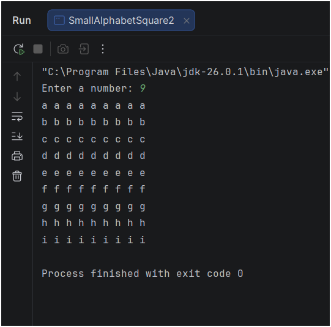

## Java Practice Question – Small Alphabet Square Pattern (Variation 2)

This folder contains a Java program that solves a **pattern-printing practice question** demonstrating a variation of the lowercase alphabet square pattern using nested `for` loops and ASCII character typecasting.

It is intended for beginners to strengthen their understanding of **core Java fundamentals**, specifically exploring how changing the loop variable mapped to ASCII values alters the repeated lowercase character structure across rows or columns.

## 📌 Program Overview

The program in this folder covers the following practice concepts:

* Reading the grid size (`n`) from the user using the `Scanner` class.

* Using an outer `for` loop (`i` from `1` to `n`) to manage the rows of the square grid.

* Using an inner `for` loop (`j` from `1` to `n`) to print `n` lowercase characters per row.

* Mapping the outer row counter (`i`) or an alternate sequence to lowercase ASCII characters (e.g., `(char)(i + 96)` or `(char)('a' + i - 1)` so each row repeats the same lowercase letter like `a a a`, `b b b`, `c c c`).

* Using `System.out.print()` and `System.out.println()` to format the grid cleanly in the console.

## 🧪 Code Functionality

The program demonstrates:

### Nested Loops & Row-Based Lowercase ASCII Mapping

* **User Input**: Prompts the user to enter an integer `n` representing the dimensions (`n × n`) of the square pattern.

* **Pattern Generation**: Iterates through `n` rows and `n` columns, converting the row index into its corresponding lowercase ASCII character to produce a distinct square pattern variation.

The program is written in a **simple and readable format**, making it ideal for beginners learning how loop variable dependencies control character patterns in Java.

## 🖥️ Output

The program prompts the user for the size `n` and prints the second variation of the lowercase alphabet square pattern in the console.

The complete console output for this practice question is shown below:

## 📂 File Information

* `SmallAlphabetSquare2.java` — Contains the practice question program

* `Output.png` — Screenshot of console output

* `README.md` — Folder documentation

## 👨‍💻 Author

**MD Shahnawaz Noor**

*Aspiring Data Scientist*

GitHub: <https://github.com/shahnawaznoor2020-code>

Email: shahnawaznoor2020@gmail.com

## ⭐ Note

These practice programs help build a strong foundation in Java.

Practicing different variations of lowercase alphabet squares deepens your intuition for row-versus-column loop dependencies and ASCII character arithmetic.