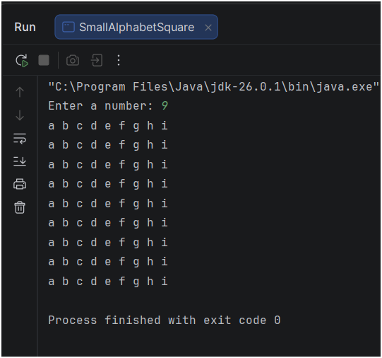

## Java Practice Question – Small Alphabet Square Pattern

This folder contains a Java program that solves a **pattern-printing practice question** demonstrating how to print a square grid of lowercase alphabets (`a`, `b`, `c`, ...) using nested `for` loops and ASCII character typecasting.

It is intended for beginners to strengthen their understanding of **core Java fundamentals**, specifically combining equal row and column loop bounds with ASCII manipulation (`'a'` = 97) to generate structured lowercase character grids in the console.

## 📌 Program Overview

The program in this folder covers the following practice concepts:

* Reading the grid size (`n`) from the user using the `Scanner` class.

* Using an outer `for` loop (`i` from `1` to `n`) to iterate through each row of the square.

* Using an inner `for` loop (`j` from `1` to `n`) to print `n` lowercase letters across each row.

* Converting integer indices to lowercase characters using ASCII arithmetic (e.g., `(char)(j + 96)` or `(char)('a' + j - 1)`).

* Using `System.out.print()` for inline spacing and `System.out.println()` to move to a new line after completing each row.

## 🧪 Code Functionality

The program demonstrates:

### Nested Loops & Lowercase ASCII Character Mapping

* **User Input**: Prompts the user to enter an integer `n` representing the dimensions (`n × n`) of the square pattern.

* **Pattern Generation**: For each of the `n` rows, prints the first `n` lowercase letters of the English alphabet (`a` through the `n`-th letter), forming a symmetrical square grid.

The program is written in a **simple and readable format**, making it ideal for beginners learning how to map numeric loop counters to lowercase ASCII characters in Java.

## 🖥️ Output

The program prompts the user for the size `n` and prints the lowercase alphabet square pattern in the console.

The complete console output for this practice question is shown below:

## 📂 File Information

* `SmallAlphabetSquare.java` — Contains the practice question program

* `Output.png` — Screenshot of console output

* `README.md` — Folder documentation

## 👨‍💻 Author

**MD Shahnawaz Noor**

*Aspiring Data Scientist*

GitHub: <https://github.com/shahnawaznoor2020-code>

Email: shahnawaznoor2020@gmail.com

## ⭐ Note

These practice programs help build a strong foundation in Java.

Practicing lowercase alphabet squares reinforces symmetric nested loop structures and ASCII value manipulation for lowercase characters.