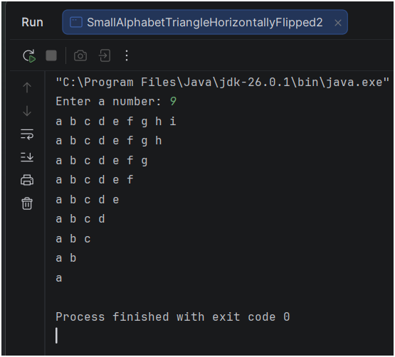

## Java Practice Question – Horizontally Flipped Small Alphabet Triangle Pattern (Variation 2)

This folder contains a Java program that solves a **pattern-printing practice question** demonstrating how to construct an inverted (horizontally flipped) right-angled triangle of lowercase alphabetical characters using nested `for` loops and ASCII character typecasting.

It is intended for beginners to strengthen their understanding of **core Java fundamentals**, specifically practicing how decreasing inner loop bounds interact with row-based or column-based ASCII character mapping.

## 📌 Program Overview

The program in this folder covers the following practice concepts:

* Reading the number of rows (`n`) from the user using the `Scanner` class.

* Using an outer `for` loop (`i` from `1` to `n`) to control the total number of rows in the inverted triangle.

* Using an inner `for` loop (`j` from `1` to `n + 1 - i` or decrementing from `n` down to `i`) so the number of lowercase letters printed decreases with each subsequent row.

* Mapping the outer row counter or inner column counter to lowercase ASCII characters (e.g., `(char)(i + 96)` to repeat the row's lowercase letter such as `a a a a`, `b b b`, `c c`, `d`).

* Using `System.out.print()` and `System.out.println()` to format the inverted triangular output cleanly in the console.

## 🧪 Code Functionality

The program demonstrates:

### Inverted Nested Loops & Lowercase ASCII Arithmetic

* **User Input**: Prompts the user to enter an integer `n` representing the height (number of rows) of the inverted triangle.

* **Pattern Generation**: Iterates row by row, printing a decreasing count of lowercase alphabetical characters per row based on the current row index and advancing to a new line after each row completes.

The program is written in a **simple and readable format**, making it ideal for beginners learning inverted loop bounds and ASCII character typecasting in Java.

## 🖥️ Output

The program prompts the user for the number of rows `n` and prints the horizontally flipped lowercase alphabet triangle pattern in the console.

The complete console output for this practice question is shown below:

## 📂 File Information

* `SmallAlphabetTriangleHorizontallyFlipped2.java` — Contains the practice question program

* `Output.png` — Screenshot of console output

* `README.md` — Folder documentation

## 👨‍💻 Author

**MD Shahnawaz Noor**

*Aspiring Data Scientist*

GitHub: <https://github.com/shahnawaznoor2020-code>

Email: shahnawaznoor2020@gmail.com

## ⭐ Note

These practice programs help build a strong foundation in Java.

Exploring different variations of inverted character triangles reinforces your mastery of nested loop boundaries and ASCII character conversions.