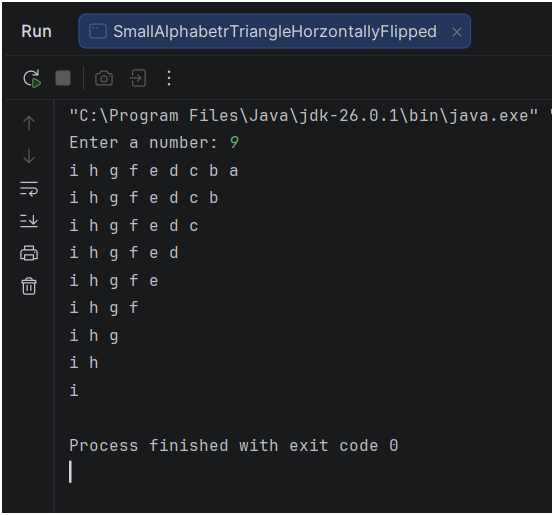

## Java Practice Question – Horizontally Flipped Small Alphabet Triangle Pattern

This folder contains a Java program that solves a **pattern-printing practice question** demonstrating how to print a horizontally flipped (inverted) right-angled triangle of lowercase alphabets (`a`, `b`, `c`, ...) using nested `for` loops and ASCII character typecasting.

It is intended for beginners to strengthen their understanding of **core Java fundamentals**, specifically combining decreasing row counts with ASCII manipulation (`'a'` = 97) to generate inverted character patterns in the console.

## 📌 Program Overview

The program in this folder covers the following practice concepts:

* Reading the number of rows (`n`) from the user using the `Scanner` class.

* Using an outer `for` loop (`i` from `1` to `n`) to iterate through each row from top to bottom.

* Using an inner `for` loop (`j` from `1` to `n + 1 - i`) to print a decreasing number of lowercase letters on each subsequent row.

* Converting integer column indices to lowercase characters using ASCII arithmetic (e.g., `(char)(j + 96)` or `(char)('a' + j - 1)`).

* Using `System.out.print()` for inline formatting and `System.out.println()` to move to the next line after each row.

## 🧪 Code Functionality

The program demonstrates:

### Nested Loops & Inverted ASCII Character Mapping

* **User Input**: Prompts the user to enter an integer `n` representing the total number of rows in the triangle.

* **Pattern Generation**: For each row `i`, prints lowercase letters starting from `'a'` up to the `(n + 1 - i)`-th letter of the alphabet, creating an inverted right-angled triangle aligned to the left.

The program is written in a **simple and readable format**, making it ideal for beginners learning how to combine inverted loop bounds with character casting in Java.

## 🖥️ Output

The program prompts the user for the number of rows `n` and prints the horizontally flipped lowercase alphabet triangle pattern in the console.

The complete console output for this practice question is shown below:

## 📂 File Information

* `SmallAlphabetrTriangleHorzontallyFlipped.java` — Contains the practice question program

* `Output.png` — Screenshot of console output

* `README.md` — Folder documentation

## 👨‍💻 Author

**MD Shahnawaz Noor**

*Aspiring Data Scientist*

GitHub: <https://github.com/shahnawaznoor2020-code>

Email: shahnawaznoor2020@gmail.com

## ⭐ Note

These practice programs help build a strong foundation in Java.

Practicing inverted alphabet triangles reinforces both reverse loop bounds (`n + 1 - i`) and ASCII value manipulation for lowercase characters.