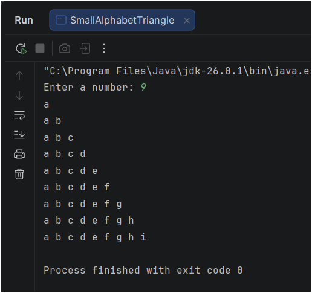

## Java Practice Question – Small Alphabet Triangle Pattern

This folder contains a Java program that solves a **pattern-printing practice question** demonstrating how to construct a right-angled triangle of lowercase alphabetical characters using nested `for` loops and ASCII character typecasting.

It is intended for beginners to strengthen their understanding of **core Java fundamentals**, specifically practicing how inner loop bounds depend on the outer row counter while converting numerical indices into lowercase letters.

## 📌 Program Overview

The program in this folder covers the following practice concepts:

* Reading the number of rows (`n`) from the user using the `Scanner` class.

* Using an outer `for` loop (`i` from `1` to `n`) to control the total number of rows in the triangle.

* Using an inner `for` loop (`j` from `1` to `i`) so the number of lowercase letters printed increases incrementally with each row.

* Mapping loop counters to lowercase ASCII characters (e.g., `(char)(j + 96)` or `(char)('a' + j - 1)` to display `a`, `a b`, `a b c`, etc.).

* Using `System.out.print()` and `System.out.println()` to format the triangular output cleanly in the console.

## 🧪 Code Functionality

The program demonstrates:

### Nested Loops & Lowercase ASCII Typecasting

* **User Input**: Prompts the user to enter an integer `n` representing the height (number of rows) of the triangle.

* **Pattern Generation**: Iterates row by row, printing lowercase alphabetical characters up to the current row index `i` and advancing to a new line after each row completes.

The program is written in a **simple and readable format**, making it ideal for beginners learning triangular loop structures and ASCII character arithmetic in Java.

## 🖥️ Output

The program prompts the user for the number of rows `n` and prints the lowercase alphabet triangle pattern in the console.

The complete console output for this practice question is shown below:

## 📂 File Information

* `SmallAlphabetTriangle.java` — Contains the practice question program

* `Output.png` — Screenshot of console output

* `README.md` — Folder documentation

## 👨‍💻 Author

**MD Shahnawaz Noor**

*Aspiring Data Scientist*

GitHub: <https://github.com/shahnawaznoor2020-code>

Email: shahnawaznoor2020@gmail.com

## ⭐ Note

These practice programs help build a strong foundation in Java.

Mastering right-angled lowercase character triangles builds confidence with nested loop dependencies and ASCII character manipulation.