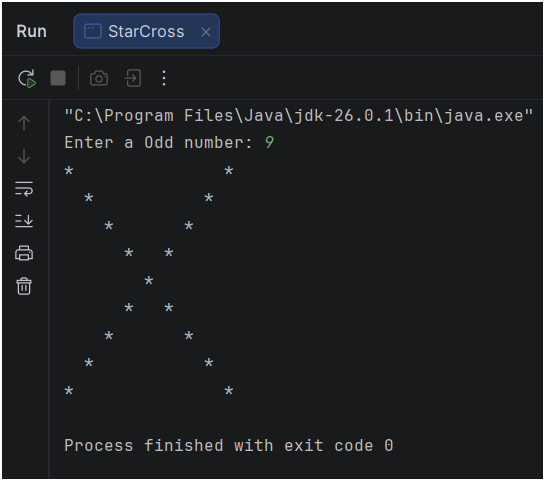
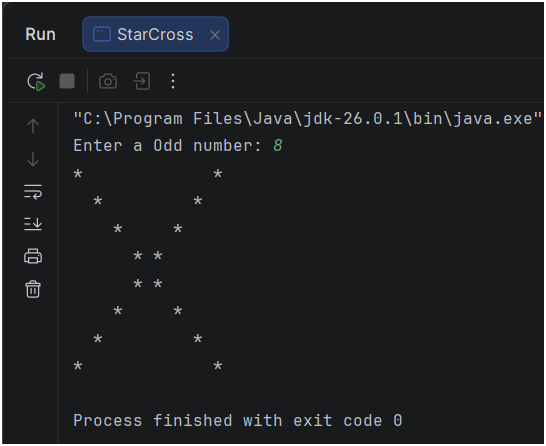

## Java Practice Question – Star Cross Pattern

This folder contains a Java program that solves a **pattern-printing practice question** demonstrating how to print an `'X'`-shaped star cross pattern inside a square grid using nested `for` loops and diagonal conditional logic.

It is intended for beginners to strengthen their understanding of **core Java fundamentals**, specifically practicing how row and column coordinates relate to main and anti-diagonals in a matrix.

## 📌 Program Overview

The program in this folder covers the following practice concepts:

* Reading the grid size (`n`, typically an odd number for a symmetric cross) from the user using the `Scanner` class.

* Using nested `for` loops (`i` from `1` to `n` for rows, and `j` from `1` to `n` for columns) to traverse an $n \times n$ grid.

* Applying `if-else` conditional checks to print an asterisk (`*`) along the two diagonals:
  * **Main Diagonal**: Where the row index equals the column index (`i == j`).
  * **Anti-Diagonal**: Where the sum of the row and column indices equals `n + 1` (`i + j == n + 1`).

* Printing spaces (`" "`) for all other coordinates so that only the intersecting diagonals remain visible.

## 🧪 Code Functionality

The program demonstrates:

### Diagonal Coordinate Logic & Conditional Printing

* **User Input**: Prompts the user to enter an integer `n` representing the number of rows and columns of the square grid.

* **Pattern Generation**: Evaluates each cell `(i, j)` in the $n \times n$ grid, printing `* ` when the cell lies on either diagonal and printing spaces otherwise, advancing to a new line after each row completes.

The program is written in a **simple and readable format**, making it ideal for beginners learning 2D grid coordinates and conditional pattern logic in Java.

## 🖥️ Output

The program prompts the user for the grid size `n` and prints the star cross pattern in the console.

The complete console outputs for different test cases are shown below:

## 📂 File Information

* `StarCross.java` — Contains the practice question program

* `Output_1.png` — Screenshot of console output (Test Case 1)

* `Output_2.png` — Screenshot of console output (Test Case 2)

* `README.md` — Folder documentation

## 👨‍💻 Author

**MD Shahnawaz Noor**

*Aspiring Data Scientist*

GitHub: <https://github.com/shahnawaznoor2020-code>

Email: shahnawaznoor2020@gmail.com

## ⭐ Note

These practice programs help build a strong foundation in Java.

Mastering diagonal conditions (`i == j` and `i + j == n + 1`) is essential for solving more complex matrix and hollow geometric pattern problems.