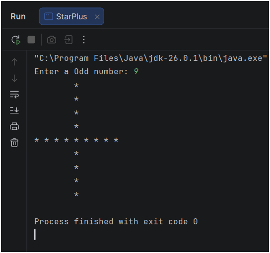

## Java Practice Question – Star Plus Pattern

This folder contains a Java program that solves a **pattern-printing practice question** demonstrating how to print a `'+'`-shaped star plus pattern inside a square grid using nested `for` loops and middle-row/column conditional logic.

It is intended for beginners to strengthen their understanding of **core Java fundamentals**, specifically practicing how to locate and target the exact center row and center column of an odd-sized matrix.

## 📌 Program Overview

The program in this folder covers the following practice concepts:

* Reading the grid size (`n`, typically an odd integer for a symmetric plus sign) from the user using the `Scanner` class.

* Calculating the middle index (`mid = n / 2 + 1`) to identify the central axes of the $n \times n$ grid.

* Using nested `for` loops (`i` from `1` to `n` for rows, and `j` from `1` to `n` for columns) to traverse the grid.

* Applying `if-else` conditional checks to print an asterisk (`*`) when either the current row or current column matches the middle index (`i == mid || j == mid`), and printing spaces otherwise.

## 🧪 Code Functionality

The program demonstrates:

### Center-Axis Coordinate Logic & Conditional Printing

* **User Input**: Prompts the user to enter an odd integer `n` representing the number of rows and columns of the square grid.

* **Pattern Generation**: Evaluates each cell `(i, j)` in the $n \times n$ grid, printing `* ` along the horizontal middle row (`i == n / 2 + 1`) and vertical middle column (`j == n / 2 + 1`), while filling all remaining cells with spaces.

The program is written in a **simple and readable format**, making it ideal for beginners learning 2D grid coordinates and conditional pattern logic in Java.

## 🖥️ Output

The program prompts the user for the grid size `n` and prints the star plus pattern in the console.

The complete console output is shown below:

## 📂 File Information

* `StarPlus.java` — Contains the practice question program

* `Output.png` — Screenshot of console output

* `README.md` — Folder documentation

## 👨‍💻 Author

**MD Shahnawaz Noor**

*Aspiring Data Scientist*

GitHub: <https://github.com/shahnawaznoor2020-code>

Email: shahnawaznoor2020@gmail.com

## ⭐ Note

These practice programs help build a strong foundation in Java.

Mastering center-axis conditions (`i == n / 2 + 1 || j == n / 2 + 1`) is essential for solving symmetric grid and hollow geometric pattern problems.