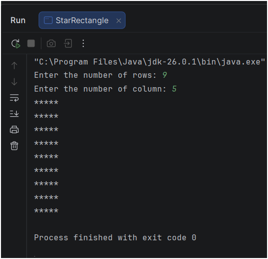

## Java Practice Question – Star Rectangle Pattern

This folder contains a Java program that solves a **pattern-printing practice question** demonstrating how to print a solid rectangular grid of asterisks (`*`) using nested `for` loops based on user-defined rows and columns.

It is intended for beginners to strengthen their understanding of **core Java fundamentals**, specifically practicing the foundational relationship between outer row loops and inner column loops.

## 📌 Program Overview

The program in this folder covers the following practice concepts:

* Reading two integer dimensions—number of rows (`m` or `rows`) and number of columns (`n` or `cols`)—from the user using the `Scanner` class.

* Using an outer `for` loop to iterate through each row from `1` to `rows`.

* Using an inner `for` loop to print an asterisk (`*`) across every column from `1` to `cols` within each row.

* Using `System.out.println()` after each inner loop completes to advance to the next line and form a neat rectangular block.

## 🧪 Code Functionality

The program demonstrates:

### Two-Dimensional Loop Control & Grid Construction

* **User Input**: Prompts the user to enter two integers representing the height (number of rows) and width (number of columns) of the rectangle.

* **Pattern Generation**: Executes the inner column loop completely for every single iteration of the outer row loop, resulting in a solid $rows \times cols$ rectangular grid of asterisks.

The program is written in a **simple and readable format**, making it the ideal starting point for beginners learning nested loops in Java.

## 🖥️ Output

The program prompts the user for the number of rows and columns and prints the solid star rectangle pattern in the console.

The complete console output is shown below:

## 📂 File Information

* `StarRectangle.java` — Contains the practice question program

* `Output.png` — Screenshot of console output

* `README.md` — Folder documentation

## 👨‍💻 Author

**MD Shahnawaz Noor**

*Aspiring Data Scientist*

GitHub: <https://github.com/shahnawaznoor2020-code>

Email: shahnawaznoor2020@gmail.com

## ⭐ Note

These practice programs help build a strong foundation in Java.

Understanding how outer loops control rows and inner loops control columns in a simple rectangle is the core building block for all complex pattern-printing problems.