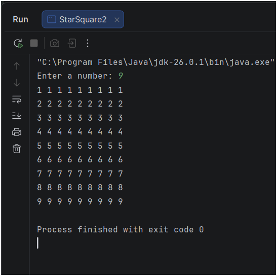

## Java Practice Question – Star Square Pattern (Variation 2)

This folder contains a Java program that solves a **pattern-printing practice question** demonstrating an alternative approach or spacing variation for printing a solid square grid of asterisks (`*`) using nested `for` loops based on a user-defined size.

It is intended for beginners to strengthen their understanding of **core Java fundamentals**, specifically practicing equal-dimension nested iteration and exploring subtle variations in loop boundaries or output formatting.

## 📌 Program Overview

The program in this folder covers the following practice concepts:

* Reading a single integer dimension (`n`) from the user using the `Scanner` class to define the square's size.

* Using an outer `for` loop to iterate through each row from `1` to `n`.

* Using an inner `for` loop to print an asterisk (`*`) across each column within the row, implementing a slight variation in loop indexing or spacing compared to the standard version.

* Using `System.out.println()` after each inner loop completes to move to the next line and maintain the square structure.

## 🧪 Code Functionality

The program demonstrates:

### Equal-Dimension Loop Control & Square Variation

* **User Input**: Prompts the user to enter a single integer representing the side length ($n$) of the square.

* **Pattern Generation**: Executes the inner column loop $n$ times for every iteration of the outer row loop, producing a symmetrical $n \times n$ grid of asterisks with adjusted formatting or loop bounds.

The program is written in a **simple and readable format**, helping beginners see how small adjustments in nested loop structure or spacing affect console output.

## 🖥️ Output

The program prompts the user for the size of the square and prints the star square pattern variation in the console.

The complete console output is shown below:

## 📂 File Information

* `StarSquare2.java` — Contains the practice question program

* `Output.png` — Screenshot of console output

* `README.md` — Folder documentation

## 👨‍💻 Author

**MD Shahnawaz Noor**

*Aspiring Data Scientist*

GitHub: <https://github.com/shahnawaznoor2020-code>

Email: shahnawaznoor2020@gmail.com

## ⭐ Note

These practice programs help build a strong foundation in Java.

Comparing different variations of the same basic pattern builds flexibility in how you structure loop conditions and control console spacing.