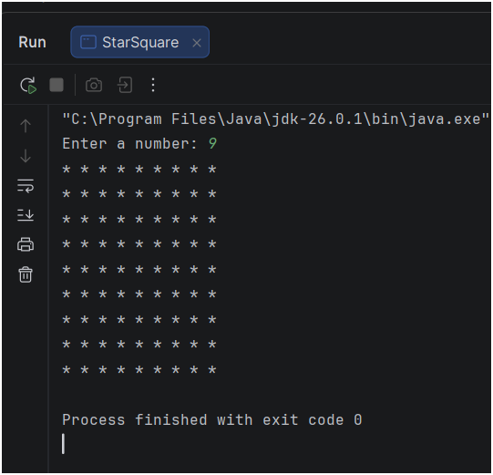

## Java Practice Question – Star Square Pattern

This folder contains a Java program that solves a **pattern-printing practice question** demonstrating how to print a solid square grid of asterisks (`*`) using nested `for` loops based on a user-defined size.

It is intended for beginners to strengthen their understanding of **core Java fundamentals**, specifically practicing equal-dimension nested iteration where the number of rows matches the number of columns.

## 📌 Program Overview

The program in this folder covers the following practice concepts:

* Reading a single integer dimension (`n`) from the user using the `Scanner` class to represent both the number of rows and columns.

* Using an outer `for` loop to iterate through each row from `1` to `n`.

* Using an inner `for` loop to print an asterisk (`*`) across every column from `1` to `n` within each row.

* Using `System.out.println()` after each inner loop completes to advance to the next line and form a symmetrical square block.

## 🧪 Code Functionality

The program demonstrates:

### Equal-Dimension Loop Control & Square Construction

* **User Input**: Prompts the user to enter a single integer representing the side length ($n$) of the square.

* **Pattern Generation**: Executes the inner column loop $n$ times for every single iteration of the outer row loop, resulting in a solid $n \times n$ square grid of asterisks.

The program is written in a **simple and readable format**, making it a foundational exercise for beginners learning nested loops in Java.

## 🖥️ Output

The program prompts the user for the size of the square and prints the solid star square pattern in the console.

The complete console output is shown below:

## 📂 File Information

* `StarSquare.java` — Contains the practice question program

* `Output.png` — Screenshot of console output

* `README.md` — Folder documentation

## 👨‍💻 Author

**MD Shahnawaz Noor**

*Aspiring Data Scientist*

GitHub: <https://github.com/shahnawaznoor2020-code>

Email: shahnawaznoor2020@gmail.com

## ⭐ Note

These practice programs help build a strong foundation in Java.

Mastering symmetrical grid structures with equal outer and inner loop bounds helps solidify your grasp of 2D iteration logic before moving on to triangular and hollow patterns.