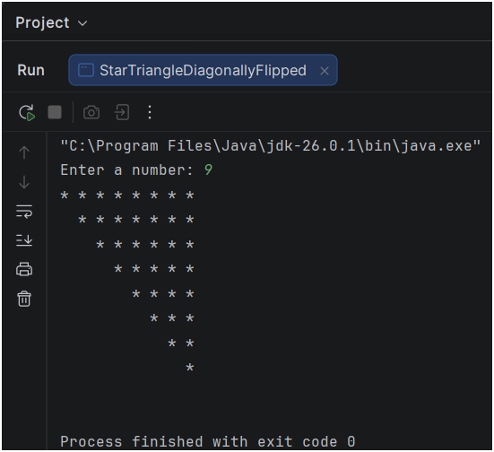

## Java Practice Question – Diagonally Flipped Star Triangle Pattern

This folder contains a Java program that solves a **pattern-printing practice question** demonstrating how to print a diagonally flipped (right-aligned) triangle of asterisks (`*`) using nested `for` loops based on a user-defined number of rows.

It is intended for beginners to strengthen their understanding of **core Java fundamentals**, specifically practicing how to combine leading spaces with printed symbols inside nested loops to shift a pattern's horizontal alignment.

## 📌 Program Overview

The program in this folder covers the following practice concepts:

* Reading a single integer (`n`) from the user using the `Scanner` class to define the height (number of rows) of the triangle.

* Using an outer `for` loop to iterate through each row from `1` to `n`.

* Using a first inner `for` loop to print leading spaces (`n - i` spaces per row) to push the stars to the right side of the console.

* Using a second inner `for` loop to print asterisks (`*`) from `1` up to the current row number (`i`), followed by `System.out.println()` to move to the next line.

## 🧪 Code Functionality

The program demonstrates:

### Leading Space Alignment & Dual Inner Loops

* **User Input**: Prompts the user to enter a single integer representing the number of rows ($n$) for the triangle.

* **Pattern Generation**: Coordinates two sequential inner loops within each row iteration—the first decreases the number of leading spaces ($n - i$) as the rows progress, while the second increases the number of printed asterisks ($i$), creating a right-aligned triangular shape.

The program is written in a **simple and readable format**, helping beginners understand how whitespace management transforms standard left-aligned patterns into flipped variations.

## 🖥️ Output

The program prompts the user for the number of rows and prints the diagonally flipped star triangle pattern in the console.

The complete console output is shown below:

## 📂 File Information

* `StarTriangleDiagonallyFlipped.java` — Contains the practice question program

* `Output.png` — Screenshot of console output

* `README.md` — Folder documentation

## 👨‍💻 Author

**MD Shahnawaz Noor**

*Aspiring Data Scientist*

GitHub: <https://github.com/shahnawaznoor2020-code>

Email: shahnawaznoor2020@gmail.com

## ⭐ Note

These practice programs help build a strong foundation in Java.

Mastering leading-space alignment in flipped triangles is an essential stepping stone toward printing centered pyramids, diamonds, and hollow geometric patterns.