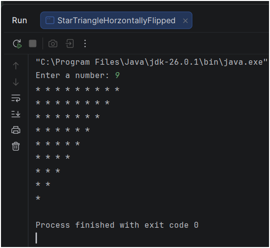

## Java Practice Question – Horizontally Flipped Star Triangle Pattern

This folder contains a Java program that solves a **pattern-printing practice question** demonstrating how to print a horizontally flipped (inverted) right-angled triangle of asterisks (`*`) using nested `for` loops based on a user-defined number of rows.

It is intended for beginners to strengthen their understanding of **core Java fundamentals**, specifically practicing how to invert loop boundaries or use decreasing counters to reverse standard geometric shapes.

## 📌 Program Overview

The program in this folder covers the following practice concepts:

* Reading a single integer (`n`) from the user using the `Scanner` class to define the height (number of rows) of the inverted triangle.

* Using an outer `for` loop to iterate through each row from `1` to `n`.

* Using an inner `for` loop to print decreasing numbers of asterisks (`*`) per row (e.g., from `1` to `n + 1 - i` or decrementing from `n` down to `i`).

* Using `System.out.println()` after each row iteration to move the cursor to a new line.

## 🧪 Code Functionality

The program demonstrates:

### Inverted Loop Boundaries & Decreasing Columns

* **User Input**: Prompts the user to enter a single integer representing the number of rows ($n$) for the inverted triangle.

* **Pattern Generation**: Adjusts the inner loop condition so that the first row prints $n$ asterisks and each subsequent row prints one fewer asterisk until the final row prints a single star ($n + 1 - i$ columns per row).

The program is written in a **simple and readable format**, helping beginners understand how modifying loop termination conditions controls pattern orientation.

## 🖥️ Output

The program prompts the user for the number of rows and prints the horizontally flipped star triangle pattern in the console.

The complete console output is shown below:

## 📂 File Information

* `StarTriangleHorzontallyFlipped.java` — Contains the practice question program

* `Output.png` — Screenshot of console output

* `README.md` — Folder documentation

## 👨‍💻 Author

**MD Shahnawaz Noor**

*Aspiring Data Scientist*

GitHub: <https://github.com/shahnawaznoor2020-code>

Email: shahnawaznoor2020@gmail.com

## ⭐ Note

These practice programs help build a strong foundation in Java.

Understanding how to invert row-to-column relationships is key to building more complex composite patterns like hourglasses and diamonds.