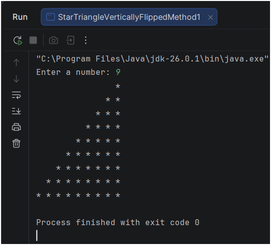

## Java Practice Question – Vertically Flipped Star Triangle Pattern (Method 1)

This folder contains a Java program that solves a **pattern-printing practice question** demonstrating how to print a vertically flipped (right-aligned) right-angled triangle of asterisks (`*`) using nested `for` loops based on a user-defined number of rows.

It is intended for beginners to strengthen their understanding of **core Java fundamentals**, specifically practicing how to combine leading space loops with star-printing loops (or conditional grid checks) to align patterns to the right.

## 📌 Program Overview

The program in this folder covers the following practice concepts:

* Reading a single integer (`n`) from the user using the `Scanner` class to define the height (number of rows) of the right-aligned triangle.

* Using an outer `for` loop to iterate through each row from `1` to `n`.

* Managing horizontal alignment by printing leading spaces before printing the asterisks (`*`) on each row (e.g., `n - i` spaces followed by `i` stars, or using conditional `if (i + j > n)` logic within a square grid).

* Using `System.out.println()` after each row iteration to move the cursor to a new line.

## 🧪 Code Functionality

The program demonstrates:

### Right-Alignment & Dual-Phase Row Rendering

* **User Input**: Prompts the user to enter a single integer representing the number of rows ($n$) for the triangle.

* **Pattern Generation**: Offsets each row with decreasing leading spaces ($n - i$) and prints increasing asterisks ($i$) so that the triangle aligns flush along its right edge.

The program is written in a **simple and readable format**, helping beginners understand how spacing and character loops work together to shift pattern alignment.

## 🖥️ Output

The program prompts the user for the number of rows and prints the vertically flipped star triangle pattern in the console.

The complete console output is shown below:

## 📂 File Information

* `StarTriangleVerticallyFlippedMethod1.java` — Contains the practice question program (Method 1)

* `Output.png` — Screenshot of console output

* `README.md` — Folder documentation

## 👨‍💻 Author

**MD Shahnawaz Noor**

*Aspiring Data Scientist*

GitHub: <https://github.com/shahnawaznoor2020-code>

Email: shahnawaznoor2020@gmail.com

## ⭐ Note

These practice programs help build a strong foundation in Java.

Mastering right-aligned triangles is an essential stepping stone toward constructing pyramids, diamonds, and hourglasses.