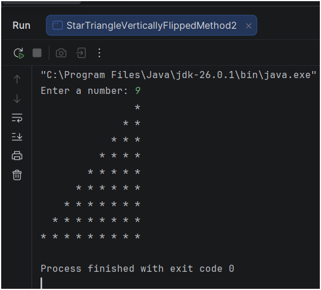

## Java Practice Question – Vertically Flipped Star Triangle Pattern (Method 2)

This folder contains a Java program that solves a **pattern-printing practice question** demonstrating an alternative approach (Method 2) to printing a vertically flipped (right-aligned) right-angled triangle of asterisks (`*`) using nested `for` loops based on a user-defined number of rows.

It is intended for beginners to strengthen their understanding of **core Java fundamentals**, specifically practicing alternative loop structures—such as using dedicated sequential inner loops for spaces and stars versus conditional `if-else` checks within a single nested loop—to achieve right-aligned geometric shapes.

## 📌 Program Overview

The program in this folder covers the following practice concepts:

* Reading a single integer (`n`) from the user using the `Scanner` class to define the height (number of rows) of the right-aligned triangle.

* Using an outer `for` loop to iterate through each row from `1` to `n`.

* Implementing an alternative inner loop strategy (Method 2)—such as separating leading space printing and star printing into two distinct sequential `for` loops (or using coordinate-based conditional logic `i + j > n`)—to align the pattern along the right edge.

* Using `System.out.println()` after each row iteration to move the cursor to a new line.

## 🧪 Code Functionality

The program demonstrates:

### Alternative Right-Alignment Strategy (Method 2)

* **User Input**: Prompts the user to enter a single integer representing the number of rows ($n$) for the triangle.

* **Pattern Generation**: Prints decreasing leading spaces ($n - i$) followed by increasing asterisks ($i$) on each row using an alternative loop design compared to Method 1, producing the exact same right-aligned triangular output.

The program is written in a **simple and readable format**, helping beginners compare different algorithmic ways to solve the same visual pattern problem.

## 🖥️ Output

The program prompts the user for the number of rows and prints the vertically flipped star triangle pattern in the console.

The complete console output is shown below:

## 📂 File Information

* `StarTriangleVerticallyFlippedMethod2.java` — Contains the practice question program (Method 2)

* `Output.png` — Screenshot of console output

* `README.md` — Folder documentation

## 👨‍💻 Author

**MD Shahnawaz Noor**

*Aspiring Data Scientist*

GitHub: <https://github.com/shahnawaznoor2020-code>

Email: shahnawaznoor2020@gmail.com

## ⭐ Note

These practice programs help build a strong foundation in Java.

Exploring multiple methods to print the same pattern sharpens logical thinking and prepares you for more complex shapes like pyramids and diamonds.