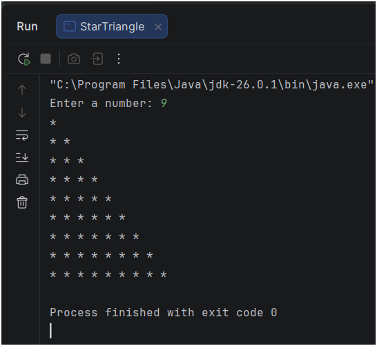

## Java Practice Question – Star Triangle Pattern

This folder contains a Java program that solves a **pattern-printing practice question** demonstrating how to print a right-angled triangle of asterisks (`*`) using nested `for` loops based on a user-defined number of rows.

It is intended for beginners to strengthen their understanding of **core Java fundamentals**, specifically practicing row-dependent loop boundaries where the number of printed symbols increases incrementally with each new line.

## 📌 Program Overview

The program in this folder covers the following practice concepts:

* Reading a single integer (`n`) from the user using the `Scanner` class to define the height (number of rows) of the triangle.

* Using an outer `for` loop to iterate through each row from `1` to `n`.

* Using an inner `for` loop that runs from `1` up to the current row number (`i`), printing an asterisk (`*`) for each column.

* Using `System.out.println()` after each inner loop completes to move to the next line and form the triangular shape.

## 🧪 Code Functionality

The program demonstrates:

### Row-Dependent Loop Control & Triangular Scaling

* **User Input**: Prompts the user to enter a single integer representing the number of rows ($n$) for the triangle.

* **Pattern Generation**: Ties the inner column loop's upper bound directly to the outer row loop's counter (`j <= i`), resulting in $1$ star on the first row, $2$ stars on the second row, and so on up to $n$ stars on the final row.

The program is written in a **simple and readable format**, helping beginners understand how to link inner and outer loop variables to create geometric shapes.

## 🖥️ Output

The program prompts the user for the number of rows and prints the star triangle pattern in the console.

The complete console output is shown below:

## 📂 File Information

* `StarTriangle.java` — Contains the practice question program

* `Output.png` — Screenshot of console output

* `README.md` — Folder documentation

## 👨‍💻 Author

**MD Shahnawaz Noor**

*Aspiring Data Scientist*

GitHub: <https://github.com/shahnawaznoor2020-code>

Email: shahnawaznoor2020@gmail.com

## ⭐ Note

These practice programs help build a strong foundation in Java.

Mastering the right-angled star triangle is a foundational step before tackling flipped triangles, pyramids, and complex character patterns.